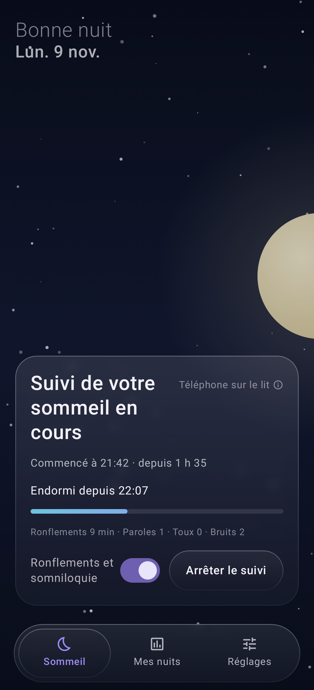

# Sleep Monitor

Application Android de suivi du sommeil, **100 % locale** (aucune permission Internet).
Conçue pour Redmagic 11 Pro (Android 16), fonctionne sur Android 14+.

- **Endormissement et réveil** détectés par les mouvements du téléphone posé sur le matelas.
- **Bruits de la nuit** classés sur le téléphone (modèle YAMNet) : ronflements, paroles
  (somniloquie), toux, bruits perturbants. Seuls de courts extraits sont gardés, durée de
  conservation réglable.
- **Récapitulatif du matin** : score, horaires, phases estimées, graphiques, extraits à réécouter,
  moyennes 7 et 30 jours.
- **Mi Fitness** via Health Connect (sur le téléphone) : sommeil et rythme cardiaque de la montre.
- Interface douce effet « vitre », fond d'écran au choix (ou photo personnelle).



## Installer

Télécharger `SleepMonitor.apk` dans les *Releases* du dépôt (ou l'artefact de la
dernière compilation GitHub Actions), l'ouvrir sur le téléphone et autoriser l'installation.
Les mises à jour s'installent par-dessus sans perdre les données (clé de signature fixe
dans `keystore/`).

## Compiler

```bash
./gradlew assembleRelease
```

Captures d'écran sans téléphone : `./gradlew testDebugUnitTest` (dossier `screenshots/`).
